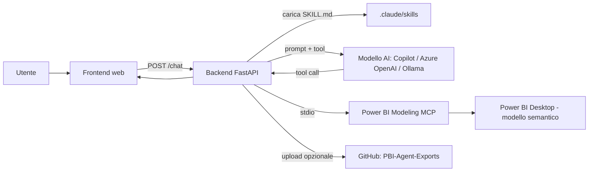

# Panoramica e architettura

## Cos'è il progetto
**PBI Agent / Skill Studio** è una webapp che permette di usare, tramite chat, un insieme di *skill* per l'analisi, la documentazione e il controllo qualità di modelli semantici Power BI. Le skill vengono eseguite da un modello AI che accede al modello Power BI aperto in Power BI Desktop tramite un **server MCP**.

Obiettivi:
- analizzare e descrivere un modello Power BI (tabelle, relazioni, misure);
- controllare integrità dei dati, relazioni e prestazioni;
- documentare il modello ed estrarre dati in Excel;
- archiviare automaticamente documenti e report in un repository GitHub (`PBI-Agent-Exports`).

## Componenti

| Componente | Descrizione | Percorso |
|---|---|---|
| Frontend | Pagina singola HTML/CSS/JS (catalogo skill, chat, cronologia, guida all'utilizzo) | `mbi-agent-webapp/static/index.html` |
| Backend | API FastAPI (Python): autenticazione, chat, orchestrazione skill, bridge MCP, archivio GitHub | `mbi-agent-webapp/main.py` |
| Provider Copilot | Integrazione con GitHub Copilot (SDK) | `mbi-agent-webapp/copilot_provider.py` |
| Skill | Istruzioni (`SKILL.md`) di ogni skill | `.claude/skills/` |
| Server MCP | Power BI Modeling MCP (accesso al modello in Power BI Desktop) | esterno (estensione VS Code / eseguibile) |
| Database locale | SQLite per sessioni di autenticazione e cronologia chat | `mbi-agent-webapp/data/` |
| Deploy | Dockerfile, Helm chart, manifest OpenShift, oauth2-proxy | `Dockerfile`, `helm/`, `mbi-agent-webapp/manifests/`, `oauth2-proxy/` |

## Flusso di una richiesta

1. L'utente seleziona una skill o scrive uno slash command (es. `/analyze`).
2. Il backend carica la `SKILL.md` corrispondente e la invia al modello AI come contesto.
3. Il modello richiama i tool MCP (loop di tool calling, massimo `MAX_TOOL_STEPS`, default 25).
4. Il backend raccoglie il risultato, lo restituisce in Markdown e, se richiesto, salva file ed esegue l'archiviazione su GitHub.

## Struttura delle cartelle del repository di lavoro

| Cartella | Contenuto |
|---|---|
| `mbi-agent-webapp/` | Webapp (backend, frontend, Dockerfile, manifest) |
| `.claude/skills/` | Catalogo delle skill |
| `PBIP/` | Progetto Power BI di esempio in formato PBIP (corso) |
| `PowerBI Custom Widget/` | Visual personalizzati (Chart&Pie, ComboBarPieProject, Gantt) |
| `Documentazione modello PBI/` | Output della skill `document-model` |
| `Estrazione tabelle/` | Output della skill `extract-table-data` |
| `reports/` | Report JSON delle analisi |
| `helm/`, `oauth2-proxy/` | Deploy su cluster e autenticazione |
| `docs/`, `greetings/`, `helloworld_project/` | Scaffolding Django/Sphinx del template di progetto (non parte della webapp) |
